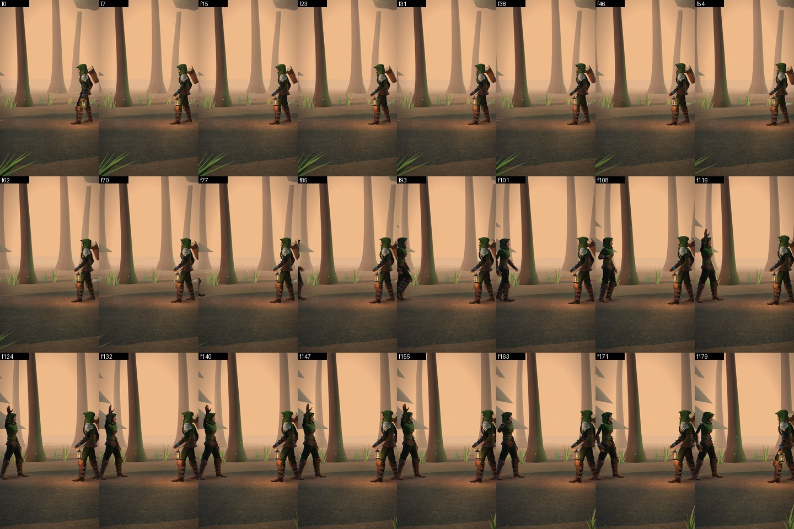
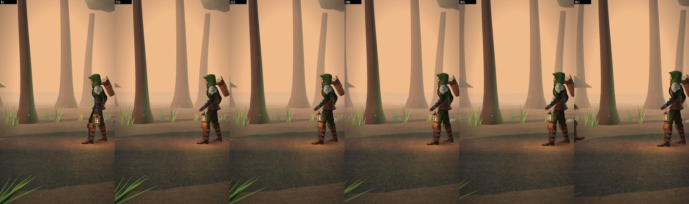
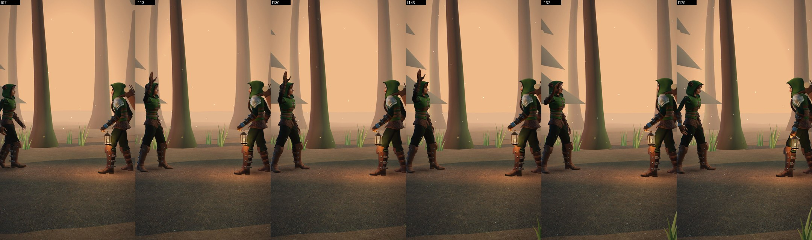

# QA report: two.mp4

**Result: no automatic problems found** (0 problems, 1 warnings)

## Output
- codec: h264
- width: 1080
- height: 1920
- fps: 30.0
- frames: 180
- duration_s: 6.059
- size_mb: 16.3
- pix_fmt: yuvj420p
- has_audio: True

## Picture
- brightness (0-255): min 105.5, mean 109.6, max 113.9
- frame-to-frame change: median 1.12, max 2.22

## Render
- ok: True
- composition: TwoCharacterTest
- frames: 180
- fps: 30
- width: 1080
- height: 1920
- concurrency: 4
- renderSeconds: 33.2
- totalSeconds: 34.7
- peakMB: 6236

## Problems
- none

## Warnings (need a human look)
- Manual review needed: open mobile-preview.jpg and mobile-preview-2.jpg (real phone size). Check that the character, the face, the prop and the subject-versus-background separation are readable. This tool does not judge them.

## Pictures

