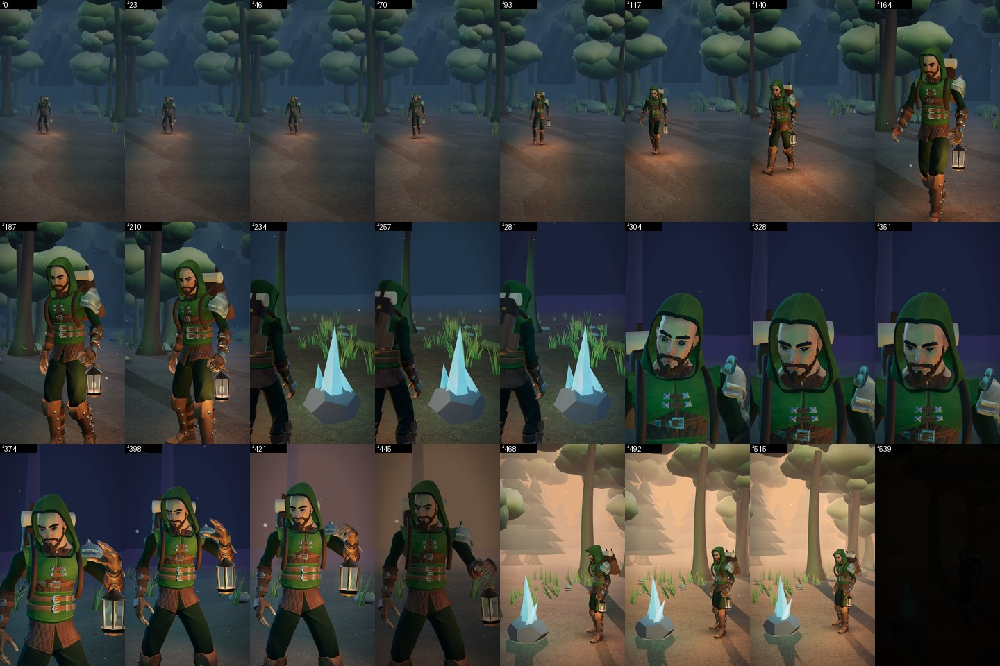
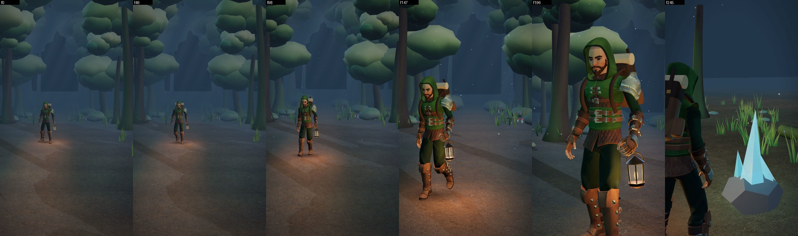
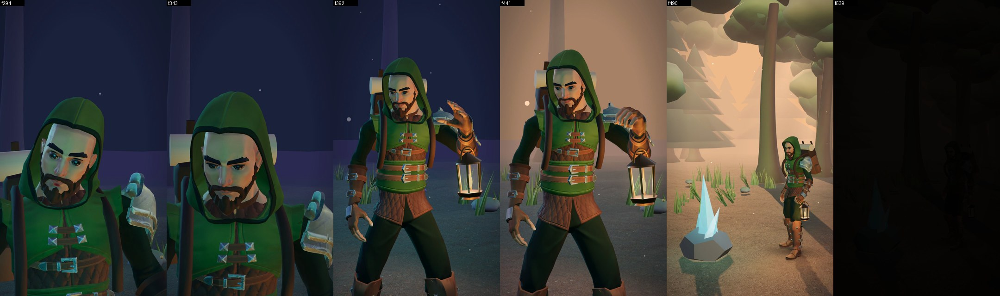

# QA report: rep_3.mp4

**Result: no automatic problems found** (0 problems, 3 warnings)

## Output
- codec: h264
- width: 1080
- height: 1920
- fps: 30.0
- frames: 540
- duration_s: 18.048
- size_mb: 35.6
- pix_fmt: yuvj420p
- has_audio: True

## Picture
- brightness (0-255): min 0.0, mean 62.3, max 120.5
- frame-to-frame change: median 1.61, max 29.4

## Render
- ok: True
- composition: StoryDemo
- frames: 540
- fps: 30
- width: 1080
- height: 1920
- concurrency: 4
- renderSeconds: 87.6
- totalSeconds: 89.1
- peakMB: 4305

## Problems
- none

## Warnings (need a human look)
- Black frames inside the planned fades: 449-451, 539 (expected).
- Large changes between frames in these ranges: 159-170, 289-291, 359-381 (threshold 6.4). A fast camera move or a fast action does this; a cut you did not list does too. Check by eye.
- Manual review needed: open mobile-preview.jpg and mobile-preview-2.jpg (real phone size). Check that the character, the face, the prop and the subject-versus-background separation are readable. This tool does not judge them.

## Pictures

