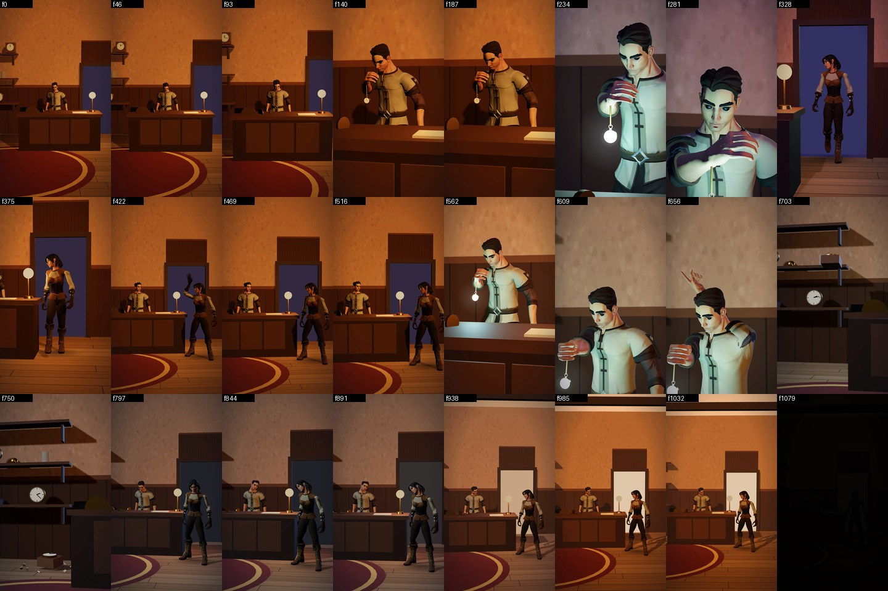
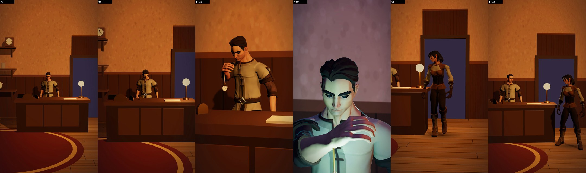
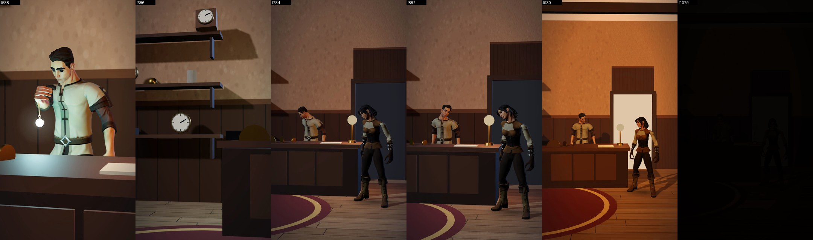

# QA report: five-seconds-ahead.mp4

**Result: no automatic problems found** (0 problems, 4 warnings)

## Output
- codec: h264
- width: 1080
- height: 1920
- fps: 30.0
- frames: 1080
- duration_s: 36.0
- size_mb: 30.6
- pix_fmt: yuvj420p
- has_audio: True

## Picture
- brightness (0-255): min 2.6, mean 64.9, max 106.3
- frame-to-frame change: median 1.01, max 60.88

## Render
- ok: True
- composition: FiveSeconds
- frames: 1080
- fps: 30
- width: 1080
- height: 1920
- concurrency: 4
- renderSeconds: 169.6
- totalSeconds: 171.8
- peakMB: 5889

## Problems
- none

## Warnings (need a human look)
- Black frames inside the planned fades: 1078-1079 (expected).
- Large changes between frames in these ranges: 241-243 (threshold 6.0). A fast camera move or a fast action does this; a cut you did not list does too. Check by eye.
- Camera moves up to 4.6 m/s inside a shot (frame 124). That may feel fast.
- Manual review needed: open mobile-preview.jpg and mobile-preview-2.jpg (real phone size). Check that the character, the face, the prop and the subject-versus-background separation are readable. This tool does not judge them.

## Pictures

